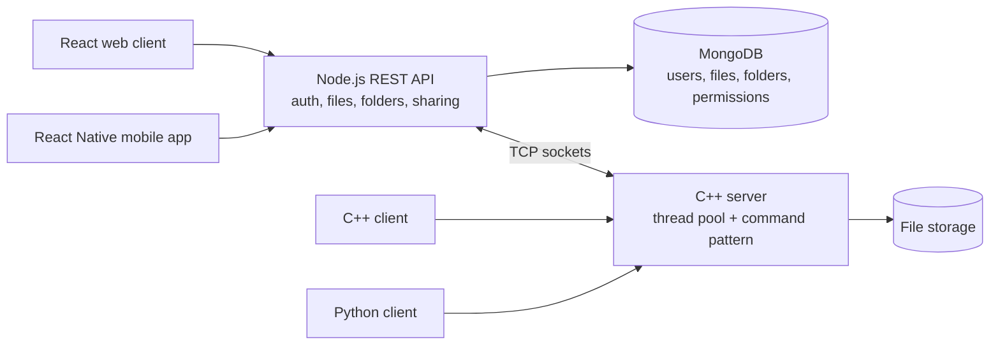
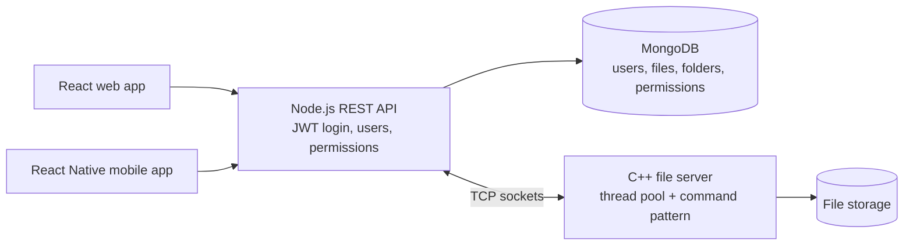

[[

https://github.com/user-attachments/assets/7154b3a5-e7dc-4e73-abe6-2434cf6c8e82

# EAD Drive Platform

**A full-stack cloud drive, built as a team of three for the Advanced Systems Programming course: a React web client and a React Native mobile app talk to a Node.js REST API, which sits on top of a multi-threaded C++ storage server and a MongoDB database. The whole system runs as containers with one command.**

---

## What it is

A file-management platform in the spirit of Google Drive. Users register, sign in, create and edit files and folders, upload images, share content with other users by email, and recover deleted items from a Bin. The same account works on the web and on a phone.

## Features

**Accounts**
- Registration and login with username or email
- Secure JWT authentication (token stored on the device)

**Files and folders**
- Create, edit, rename, move and delete files and folders
- Upload and edit images
- Soft delete: items go to a Bin and can be restored

**Sharing**
- Share a file or folder with another user by email
- Permission-based access to shared content
- Dedicated pages: Home, My Drive, Shared, Starred, Recent, Bin

**Interface**
- Side menu, item options menu, bottom tab navigation, search bar
- Dark / light mode and multi-language support
- Create/edit forms for files, pictures and folders, a move-folder form and a share form

## Architecture



- **Clients:** a React web app and a React Native (Expo) mobile app, built on the same API.
- **REST API (Node.js):** authentication, validation, permissions and metadata; talks to MongoDB for users, files, folders and sharing.
- **Storage core (C++):** a TCP server with a fixed **thread pool** that handles many clients at once. Each request is parsed, validated and run through a **command pattern** (`add`, `get`, `search`, `delete`), with mutexes protecting shared state. Text content goes through a compressor before it is stored.
- **Extra clients:** a C++ and a Python client use the same socket protocol, which is how the core was tested independently of the UI.
- **Containers:** `docker compose up --build` starts the C++ server, the Node.js server, MongoDB and the mobile dev server together, each on its own network.
- **Tests:** unit tests for the C++ core, built with CMake in their own container.

## What I worked on and learned

- Designing the **client-server architecture and the interfaces / API contracts** between the UI clients, the API layer and the core.
- Building front-end clients with a clean, consistent experience across web and mobile.
- Running a multi-component system as containerized services, and debugging and integrating components on Linux, isolating each failure to the component that caused it.
- Working as a team: code reviews, readable documented code, Git branching (one branch per task) and tasks tracked in Jira.

## Run it

1. Clone the repository (each exercise has its own branch).
2. Make sure a C++17 compiler and Docker are available.
3. Set your computer's IP in the mobile app's `.env` file (the default `10.0.2.2` is for the Android emulator).
4. Run:
   ```
   docker compose up --build
   ```
5. Open the Expo Go app (emulator or a real device), scan the QR code or enter the URL, and connect.

The Wiki has a step-by-step setup guide and a full run example with screenshots: registration, creating and editing files, sharing, deleting, restoring and settings.

## Tech stack

`JavaScript` · `React` · `React Native (Expo)` · `Node.js` · `MongoDB` · `C / C++17` · `Docker Compose` · `CMake` · `Python` (client) · `HTML / CSS / Bootstrap`

## Authors

- Ariel Golod
- Dvir Tabib
- Eylon Hakak


# driveproject-demo
](https://github.com/user-attachments/assets/7154b3a5-e7dc-4e73-abe6-2434cf6c8e82

> 🔊 The player starts muted: click the speaker icon to turn the sound on.

# EAD Drive Platform

**A full-stack cloud drive, built as a team of three for the Advanced Systems Programming course: a React web client and a React Native mobile app talk to a Node.js REST API, which sits on top of a multi-threaded C++ storage server and a MongoDB database. The whole system runs as containers with one command.**

**Source code:** [github.com/eylonh1303/ProjectGoogleDrive](https://github.com/eylonh1303/ProjectGoogleDrive/tree/FINAL) (branch `FINAL`)

---

## What it is

A file-management platform in the spirit of Google Drive. Users register, sign in, create and edit files and folders, upload images, share content with other users by email, and recover deleted items from a Bin. The same account works on the web and on a phone.

## Features

**Accounts**
- Registration and login with username or email
- Secure JWT authentication (token stored on the device)

**Files and folders**
- Create, edit, rename, move and delete files and folders
- Upload and edit images
- Soft delete: items go to a Bin and can be restored

**Sharing**
- Share a file or folder with another user by email
- Permission-based access to shared content
- Dedicated pages: Home, My Drive, Shared, Starred, Recent, Bin

**Interface**
- Side menu, item options menu, bottom tab navigation, search bar
- Dark / light mode and multi-language support
- Create/edit forms for files, pictures and folders, a move-folder form and a share form

## Architecture


- **Clients:** a React web app and a React Native (Expo) mobile app, built on the same API.
- **REST API (Node.js):** authentication, validation, permissions and metadata; talks to MongoDB for users, files, folders and sharing.
- **Storage core (C++):** a TCP server with a fixed **thread pool** that handles many clients at once. Each request is parsed, validated and run through a **command pattern** (`add`, `get`, `search`, `delete`), with mutexes protecting shared state. Text content goes through a compressor before it is stored.
- **Extra clients:** a C++ and a Python client use the same socket protocol, which is how the core was tested independently of the UI.
- **Containers:** `docker compose up --build` starts the C++ server, the Node.js server, MongoDB and the mobile dev server together, each on its own network.
- **Tests:** unit tests for the C++ core, built with CMake in their own container.

## What I worked on and learned

- Designing the **client-server architecture and the interfaces / API contracts** between the UI clients, the API layer and the core.
- Building front-end clients with a clean, consistent experience across web and mobile.
- Running a multi-component system as containerized services, and debugging and integrating components on Linux, isolating each failure to the component that caused it.
- Working as a team: code reviews, readable documented code, Git branching (one branch per task) and tasks tracked in Jira.

## Run it

1. Clone the [source repository](https://github.com/eylonh1303/ProjectGoogleDrive/tree/FINAL) (each exercise has its own branch).
2. Make sure a C++17 compiler and Docker are available.
3. Set your computer's IP in the mobile app's `.env` file (the default `10.0.2.2` is for the Android emulator).
4. Run:
   ```
   docker compose up --build
   ```
5. Open the Expo Go app (emulator or a real device), scan the QR code or enter the URL, and connect.

The Wiki in the source repository has a step-by-step setup guide and a full run example with screenshots: registration, creating and editing files, sharing, deleting, restoring and settings.

## Tech stack

`JavaScript` · `React` · `React Native (Expo)` · `Node.js` · `MongoDB` · `C / C++17` · `Docker Compose` · `CMake` · `Python` (client) · `HTML / CSS / Bootstrap`

## Authors

- Ariel Golod
- Dvir Tabib
- Eylon Hakak)
](https://github.com/user-attachments/assets/7154b3a5-e7dc-4e73-abe6-2434cf6c8e82

> 🔊 The embedded player starts muted. **[▶ Open the demo with sound](https://github.com/user-attachments/assets/7154b3a5-e7dc-4e73-abe6-2434cf6c8e82)**

# EAD Drive: Demo

**A 21-second demo of EAD, a cloud drive my team of three built from scratch for the Advanced Systems Programming course: a web app and a mobile app, a Node.js API, MongoDB, and a file server written in C++.**

This repository holds only the demo video and an explanation of the project. The source code is here: **[ProjectGoogleDrive](https://github.com/eylonh1303/ProjectGoogleDrive/tree/FINAL)** (branch `FINAL`).

> The data in the video is demo data.

---

## The idea

We wanted to understand what actually sits under a product like Google Drive, so instead of using a ready-made backend we built the whole stack ourselves: the user interface, the API, the database and the part that stores the files. Every layer is code we wrote and wired together.

## What the demo shows

1. **A working cloud drive.** Home, My Drive, Shared with me, Recent, Starred and Bin, with search and a New button, like a real drive.
2. **Organizing and sharing.** Files and folders can be shared with another user by email, with a permission level (for example Write), or made public.
3. **Dark mode and Hebrew.** One click switches to dark mode, and the whole interface flips to right-to-left Hebrew.
4. **The architecture underneath.** The React web app and the React Native mobile app talk to a Node.js API, which uses MongoDB for users, files, folders and permissions, and a C++ file server underneath, all started together with Docker Compose.

## What the app can do

- **Accounts:** register and sign in with username or email, with secure JWT authentication.
- **Files and folders:** create, edit, rename, move and delete; upload and edit images.
- **Bin:** deleted items are kept and can be restored.
- **Sharing:** share with other users by email, with permission-based access.
- **Interface:** side menu, item options menu, bottom tab navigation, search, dark / light mode, multi-language support.
- **Two clients, one account:** the same account works on the web and on a phone.

## How it is built



- **React web app and React Native mobile app:** two clients built on the same API.
- **Node.js REST API:** login, validation, permissions and metadata.
- **MongoDB:** stores users, files, folders and who can access what.
- **C++ file server:** a TCP server with a thread pool that serves many clients at once. Requests are parsed and run through a command pattern (`add`, `get`, `search`, `delete`), and text content is compressed before it is stored.
- **Docker Compose:** the whole system starts with one command.
- **Tests:** unit tests for the C++ core.

## Tech stack

`JavaScript` · `React` · `React Native (Expo)` · `Node.js` · `MongoDB` · `C / C++17` · `Docker Compose` · `CMake` · `Python` · `HTML / CSS / Bootstrap`

## Team

- Ariel Golod
- Dvir Tabib
- Eylon Hakak)
